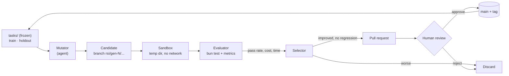
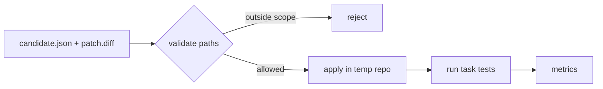
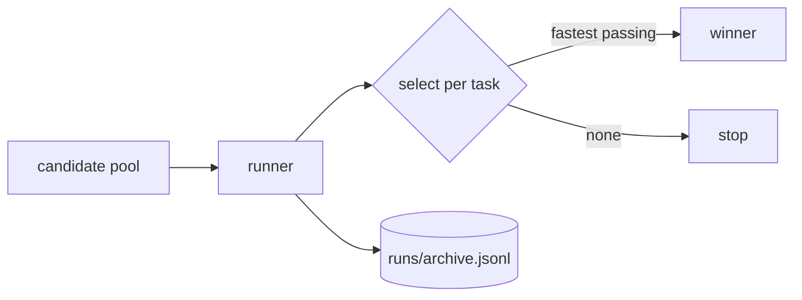
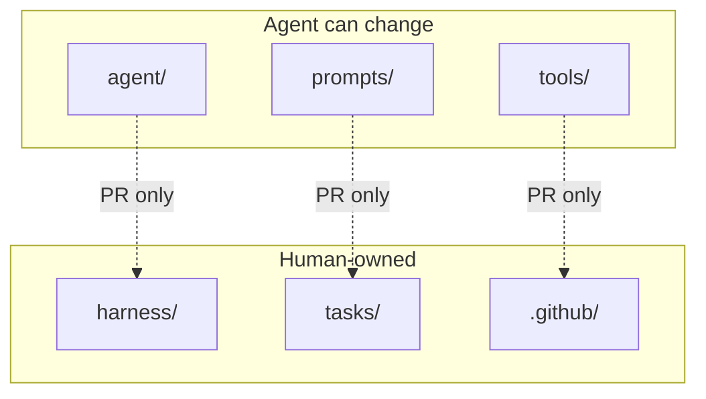
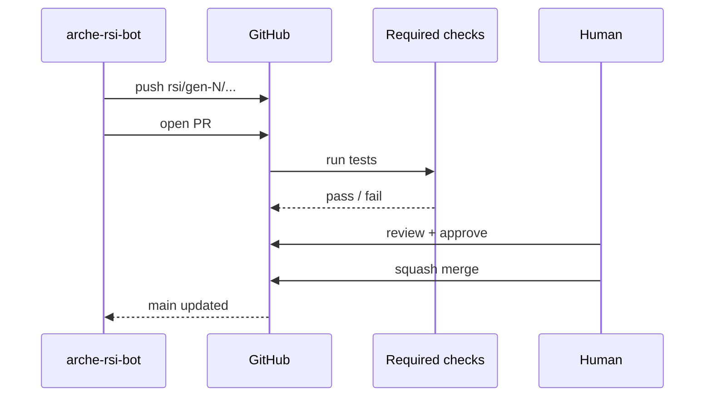

# Arche

**元** — a self-improving agent that changes itself through reviewed Git commits.

Arche is an experiment in recursive self-improvement at the code level. The agent
proposes patches to its own code, the harness measures them in a sandbox, and a
human merges only what survives.

## Current status

| Milestone | What | State |
|---|---|---|
| Bootstrap | Repo, design, GitHub App, branch protection | done |
| M0 | Task runner + 5 tasks, good/bad separation | done (#2) |
| Candidate pipeline | Diff application + path guard | done (#3) |
| Selection + archive | Per-task winner, JSONL lineage | in review (#4) |
| M1 | LLM mutator, one generation | next |
| M2 | Multi-generation, lineage, budget guard | pending |
| M3 | Self-modifying `agent/` under human gate | pending |

Last updated: 2026-11-02. This file is updated with every milestone.

## How it works



The loop is only as good as the evaluator. M0 exists to prove the evaluator can
tell a good patch from a bad one before any model is involved.

## Candidate pipeline



A candidate is a unified diff plus a small manifest. The guard runs before
anything executes: absolute paths and `..` segments are rejected, and in self
mode only `agent/`, `prompts/`, `tools/`, `docs/`, `README.md`, and `DESIGN.md`
are mutable.

## Selection and lineage



Every run appends one JSONL record per candidate: time, task, pass/fail, and
duration. The selector picks the fastest passing candidate for each task. A task
with no passing candidate stops the loop instead of falling back to an older
result.

## Trust boundary



- The agent pushes branches. It cannot merge, edit workflows, or read secrets.
- `main` requires a pull request, one approval, and a linear history.
- `harness/`, `tasks/`, and `.github/` are owned by a human in `CODEOWNERS`.

## Who does what



The bot cannot approve its own PR, and it has no merge permission. The merge
button is the human gate.

## Repository layout

```text
arche/
  harness/        # runner + suite (frozen)
  tasks/          # task repos, tests, good/bad overlays (frozen)
  agent/          # the part that will change itself (later)
  scripts/        # token helper
  DESIGN.md       # full design and threat model
```

## Run the harness

```bash
bun run m0                                    # good/bad separation on all tasks
bun test harness                              # guard and candidate tests
bun run candidate candidates/slugify-fix      # apply a real diff and score it
bun run loop                                  # score the whole candidate pool
```

Expected:

```
5/5 tasks separated good from bad
```

## What the harness proves

- A task can be reproduced in an isolated temp directory.
- A good patch passes its tests; a bad patch fails them.
- A candidate diff is applied to a fresh copy and scored by the task's tests.
- A diff that escapes the mutable scope is rejected before it runs.
- A task with no passing candidate fails the loop instead of silently reusing the last winner.
- A mismatch fails the suite with a non-zero exit code.

What it does not prove: that the tasks are hard enough, or that the model cannot
game the tests. That is M1's problem.

## Design

See [DESIGN.md](./DESIGN.md) for the threat model, mutable boundary, evaluation
rules, and the Git/GitHub safety model.
